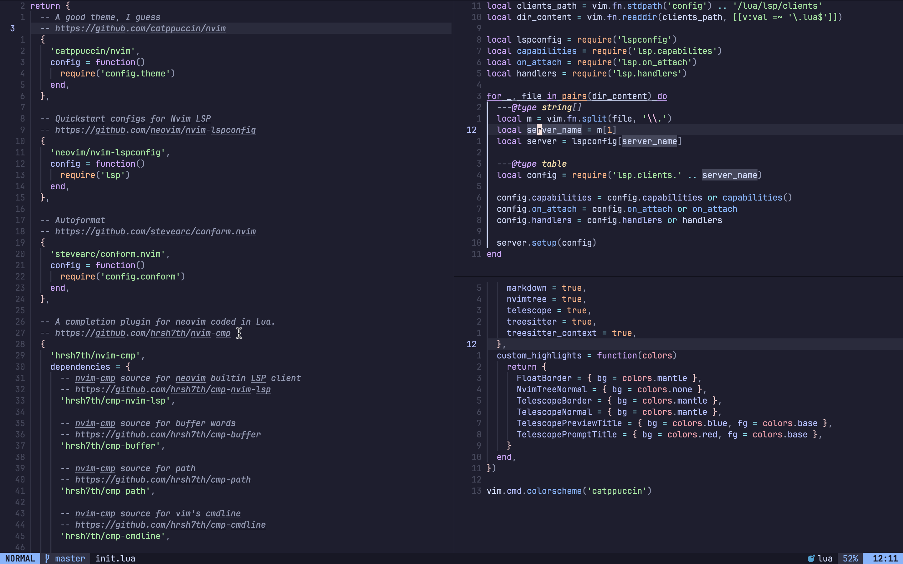

## ssiyad/neovim
This repository contains my personal Neovim configuration. It is intentionally
minimal in functional and aesthetic aspects. Feel free to use it as a base for
your own setup.

## Features
- Plugin management with the built-in `vim.pack`. Versions are locked in
  `nvim-pack-lock.json`.
- One file for each plugin in `plugin/`.
- LSP with `nvim-lspconfig`. Each file in `after/lsp/` enables one server.
- Autocomplete with `blink.cmp`.
- Format on save with `conform.nvim`.
- Treesitter for syntax highlighting.
- `mini.pick` for fuzzy finding and `mini.files` as file explorer.
- Notes with `obsidian.nvim`.
- [Acid](https://github.com/acid-theme/neovim) color scheme.



## Installation
### Prerequisites
- Neovim 0.12 or later (for `vim.pack`)
- Git
- The language servers and formatters that you want to use, in your `PATH`

### Steps
```sh
git clone https://github.com/ssiyad/nvim ~/.config/nvim
```
Start Neovim. `vim.pack` installs the plugins on the first start. To update
the plugins, run `:lua vim.pack.update()`.

## Contributing
Feel free to submit issues or pull requests to enhance the configuration.
